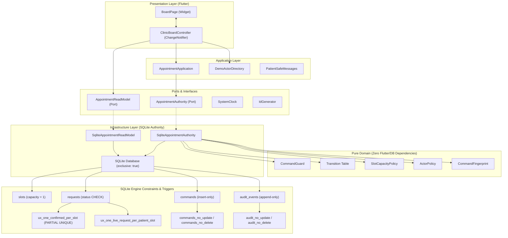
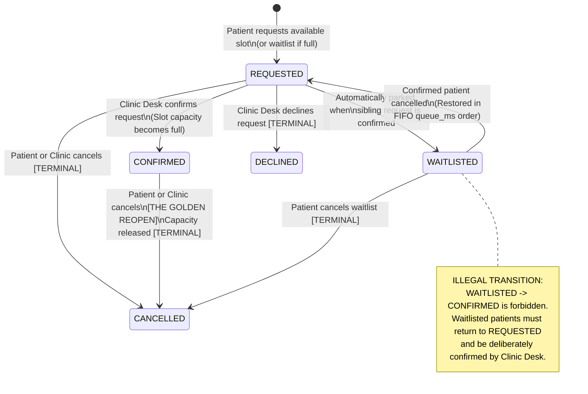
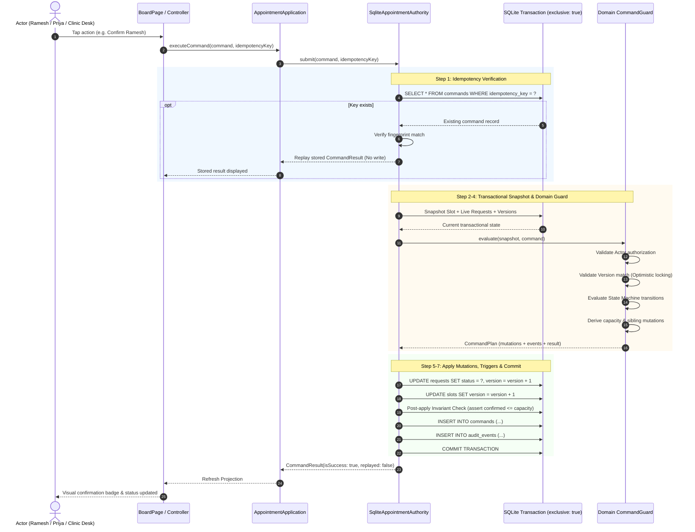

# OPD Slot Guard

> **Zero-Double-Booking Outpatient Appointment Authority**  
> Built on Flutter, Clean Architecture, and an In-Process SQLite Authority with Exclusive Writer Semantics.

[](test/)
[](lib/)
[](docs/)
[](pubspec.yaml)

---

## Executive Summary

OPD Slot Guard solves the double-booking and phantom-capacity failures common in high-concurrency outpatient clinic booking desks. 

Rather than relying on UI-level button disabling or optimistic client state, OPD Slot Guard places all booking rules behind a **single, strictly transactional SQLite mutation boundary** (`AppointmentAuthority.submit()`). Every mutation is guarded by:
1. **Insert-only Idempotency Keys** (`commands` table with canonical fingerprinting).
2. **Deterministic State Machine Rules** (`CommandGuard`, `SlotCapacityPolicy`, `ActorPolicy`).
3. **Database Constraints & Partial Unique Indexes** (`ux_one_confirmed_per_slot`, `ux_one_live_request_per_patient_slot`).
4. **Append-Only Triggers** enforcing immutability on `commands` and `audit_events`.
5. **The Golden Reopen Invariant**: Cancelling a confirmed appointment reopens capacity and returns waitlisted patients to `REQUESTED` in FIFO queue order, but **never automatically confirms anyone**.

---

## Visual Architecture

### 1. Layered Component Boundaries



---

## Domain State Machine & Lifecycle



---

## Transactional Pipeline (`AppointmentAuthority.submit`)

Every write operation executes inside an exclusive SQLite transaction with the following 7-step pipeline:



---

## Senior Architect Verification & Invariants

| Invariant | Description | Architectural Enforcement |
| :--- | :--- | :--- |
| **I1** | Exactly one confirmed patient per slot | Partial unique index `ux_one_confirmed_per_slot WHERE status = 'CONFIRMED'`. |
| **I4 / Demo 2** | The Golden Reopen | Cancelling `CONFIRMED` reopens the slot and returns `WAITLISTED` $\to$ `REQUESTED` in strict `queue_ms` FIFO order. **Never auto-confirms**. |
| **I5** | Waitlist cannot skip queue | `WAITLISTED -> CONFIRMED` is an illegal transition in `transition.dart`. |
| **I7** | Slot availability is purely derived | There is **no mutable status column** on `slots`. Available iff `confirmed_count < capacity`. |
| **I17 & I18** | Privacy & Projections | Patients can only see their own requests and status. Only Clinic Desk sees all competing patients. |
| **I19 & I20** | Immutable Audit Trail | SQLite Triggers `audit_no_update` and `audit_no_delete` abort any update or deletion on `audit_events`. |
| **I21** | Insert-Only Commands | SQLite Triggers `commands_no_update` and `commands_no_delete` protect the idempotency log. |
| **I24** | Server-Assigned Queue Time | `queue_ms` is assigned strictly by `Authority` from `SystemClock`. Never accepted from clients. |

---

## How to Run & Test

### 1. Run on Windows Desktop (Native)
Run the application directly on Windows:
```powershell
flutter run -d windows
```
*A native Windows desktop window will launch with the interactive OPD Board.*

---

### 2. Run in Android Studio & Android Emulator
1. Open **Android Studio** and choose **File $\rightarrow$ Open...** $\rightarrow$ select `D:\Mal Hackathon`.
2. Start the Android Emulator (`Medium Phone API 37.0` or any API 30+ AVD).
3. Select your device from the target device dropdown.
4. Click the green **Run** ▶ button (or press `Shift + F10`).
   > *Note on `--start-paused`*: If you click **Debug** (bug icon), Android Studio starts Flutter in paused mode. Simply press **Resume (F9)** to proceed to the main screen.

---

### 3. Testing on iOS Devices
Apple requires **macOS with Xcode** to compile native iOS binaries (`.ipa`) or run the iOS Simulator.
To run this repository on an iOS device:
1. Clone the repository onto a Mac:
   ```bash
   git clone https://github.com/Aayush-pixel29/OPD-Slot-Guard.git
   cd OPD-Slot-Guard
   ```
2. Connect your iPhone via USB and trust the computer.
3. Run:
   ```bash
   flutter run -d ios
   ```
*(All business logic, SQLite triggers, and domain state machines are cross-platform standard Dart/SQLite and function identically on iOS).*

---

### 4. Running the Complete Verification Suite

The repository includes a 100% comprehensive test suite covering all domain rules, schema constraints, triggers, demos, and chaos scenarios:

```bash
# Static analysis (0 errors, 0 warnings, 0 lints)
flutter analyze

# Complete test suite (97 tests passed)
flutter test
```

#### Test Suite Breakdown:
- **`test/domain/`**: State machine transitions, capacity policies, actor authorization, canonical fingerprints, and guard evaluations.
- **`test/infrastructure/schema_test.dart`**: SQLite partial unique indexes, foreign keys, and append-only triggers.
- **`test/infrastructure/demo1_test.dart`**: Demo 1 (Ramesh requests, Priya requests, Clinic Desk confirms).
- **`test/infrastructure/demo2_test.dart`**: Demo 2 (Golden Reopen: Ramesh cancels, Priya restored to REQUESTED, not auto-confirmed).
- **`test/infrastructure/demo3_test.dart`**: Demo 3 (ACK_LOST network simulation, bounded replay, zero duplicate mutation).
- **`test/infrastructure/invariants_test.dart`**: Invariants I1 through I24 verification.
- **`test/presentation/`**: Controller state transitions and widget rendering.

---

## The 3 Interactive Demos (Runbook)

### **Demo 1: Request Competition & Waitlist Parking**
1. Switch actor to **Ramesh** $\rightarrow$ tap **6:30 PM (Demo Primary)** $\rightarrow$ tap **Request Slot** (Status: `REQUESTED`).
2. Switch actor to **Priya** $\rightarrow$ tap **6:30 PM** $\rightarrow$ tap **Request Slot** (Status: `REQUESTED`).
3. Switch actor to **Clinic Desk** $\rightarrow$ tap **6:30 PM** $\rightarrow$ tap **Confirm** next to Ramesh.
4. **Result**: Ramesh is `CONFIRMED`, Priya is parked into `WAITLISTED`, and slot badge becomes `BOOKED`.

### **Demo 2: The Golden Reopen**
1. Switch actor to **Ramesh** $\rightarrow$ tap **6:30 PM** $\rightarrow$ tap **Cancel Appointment**.
2. **Result**: 
   - Ramesh transitions to `CANCELLED`.
   - Slot capacity reopens to `AVAILABLE`.
   - Priya returns from `WAITLISTED` $\rightarrow$ `REQUESTED` in FIFO priority order.
   - **Priya is NOT auto-confirmed**.

### **Demo 3: Lost ACK & Idempotent Replay**
1. Tap the **Diagnostics & Chaos** icon (stethoscope icon in top AppBar).
2. Under "Inject Network Failure", select **`ACK_LOST`**.
3. Close the diagnostics sheet and trigger a mutation as Clinic Desk.
4. **Result**:
   - Connection loss warning banner appears.
   - The application automatically replays the command with the exact same idempotency key.
   - The authoritative committed state is recovered with **zero duplicate row mutations**.
5. Tap **Reset Demo Data** in Diagnostics anytime to restore the seed state.

---

## Architectural Documentation

Full architectural decisions and design specifications are preserved in the `docs/` directory:
- [01-SOLUTION-BRIEF.md](docs/01-SOLUTION-BRIEF.md) — Product boundary, actor definitions, and core requirements.
- [02-HLD.md](docs/02-HLD.md) — High-Level Design, ports & adapters, component diagrams.
- [03-LLD.md](docs/03-LLD.md) — Low-Level Design, SQLite schema, triggers, pipeline execution.
- [ADR-01](docs/ADR-01-AUTHORITY-LOCAL-FIRST.md) — Single in-process SQLite authority.
- [ADR-02](docs/ADR-02-COMMAND-IDEMPOTENCY.md) — Command idempotency & fingerprinting.
- [ADR-03](docs/ADR-03-POLICY-PROVIDER-BOUNDARIES.md) — Policy provider boundaries.
- [DEMO-RUNBOOK.md](docs/DEMO-RUNBOOK.md) — Scripted demo scenarios for evaluators.
- [FAILURE-MATRIX.md](docs/FAILURE-MATRIX.md) — Complete error code and recovery behavior matrix.
- [JUDGE-DEFENSE.md](docs/JUDGE-DEFENSE.md) — Architectural defenses and technical Q&A.
- [TEST-PLAN.md](docs/TEST-PLAN.md) — Comprehensive testing matrix.
